# Jobizzi

Un tool personale per cercare lavoro, che gira in locale, su una macchina mia. Raccoglie le offerte da più fonti pubbliche, toglie i doppioni, le filtra con regole esplicite, le ordina e me le mostra in una pagina web e in un bot Telegram. Io decido: ✓ "candidatura inviata" oppure ✗ "scarta".

Non invia candidature, non scrive lettere di presentazione e **non fa login su nessun portale**: legge solo pagine ed endpoint pubblici. Costo zero, nessun servizio a pagamento.

> Questo repository è una **vetrina**: descrive il progetto, non contiene il codice. Il codice non è pubblico, ma lo mostro volentieri in un colloquio.

**In breve:** invece di scorrere ogni giorno dieci siti di annunci, un programma li legge per me tre volte al giorno, scarta i doppioni e le offerte fuori zona, mette in cima quelle più adatte e me le segnala su Telegram. Ho scelto le regole e le soglie, l'ho costruito end-to-end (raccolta, database, sito, bot, test) e lo uso ogni giorno.

## Perché l'ho fatto

Secondo me i portali di lavoro hanno in gran parte perso il loro scopo e hanno preso la strada dei social network: feed ordinati da algoritmi, notifiche, scroll infinito. Chi cerca lavoro dovrebbe avere uno strumento che fa quello che gli serve, cioè trovare le offerte giuste e lasciarlo andare, non una piattaforma che guadagna se resta lì il più a lungo possibile.

Siamo già circondati da social che ci assorbono, e la ricerca del lavoro non dovrebbe diventare un altro. Jobizzi fa il contrario: legge gli annunci al posto mio, mi mostra solo quelli che passano le mie regole, e quando ho finito di giudicarli la pagina è finita. Niente feed infinito, niente algoritmo che decide per me.

Prima di scrivere una riga di codice ho valutato se esistesse già uno strumento del genere e ho passato in rassegna portali, API e fonti pubbliche, scartandone diverse per condizioni d'uso, fragilità o mancanza di dati affidabili. Non ho trovato uno strumento pubblico, già configurato per il mercato italiano, che facesse questo: raccogliere da più fonti, togliere i doppioni, filtrare per zona e ordinare per adattamento, con un feedback che resta a chi cerca. Così l'ho costruito.

## Chi è Bizzi

Bizzi è il mio cane (Vincent), e in Jobizzi fa l'investigatore e la mascotte: "annusa" gli annunci, dà un verdetto su ciascuno e ti dice quando è in cuccia in attesa del prossimo giro. Il progetto unisce due cose che mi piacciono, la tecnica e i cani. Dovrà pur guadagnarsi le crocchette e i giochi.

## Anteprima

Il sito locale: stato dell'ultimo giro per fonte, ricerca per zona (il quadrante a destra) e lista ordinata per adattamento.

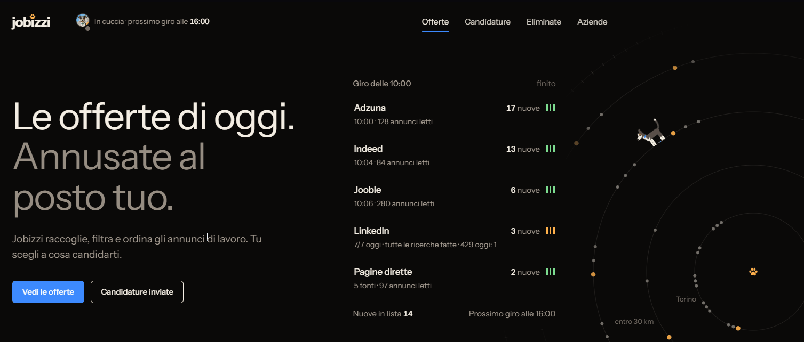

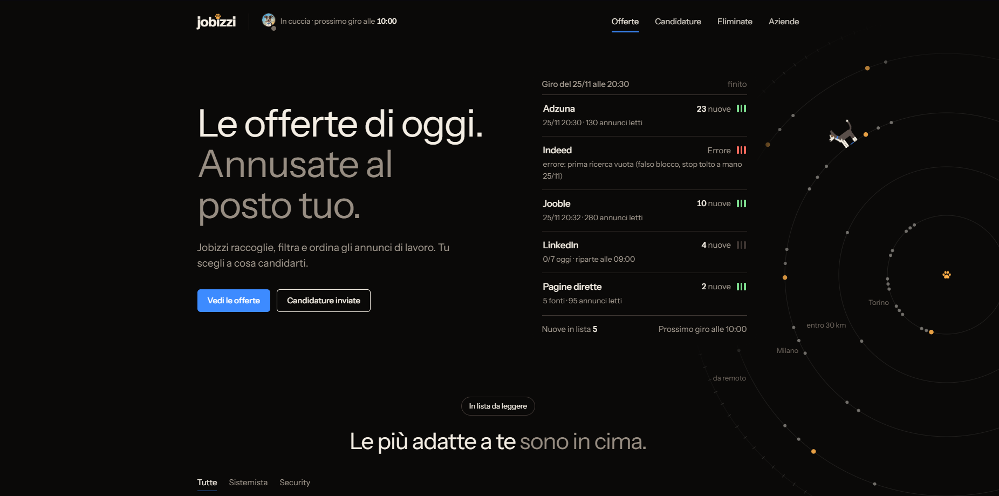

Ogni offerta mostra il verdetto di Bizzi, i motivi a favore e contro, e i bottoni per segnare l'esito.

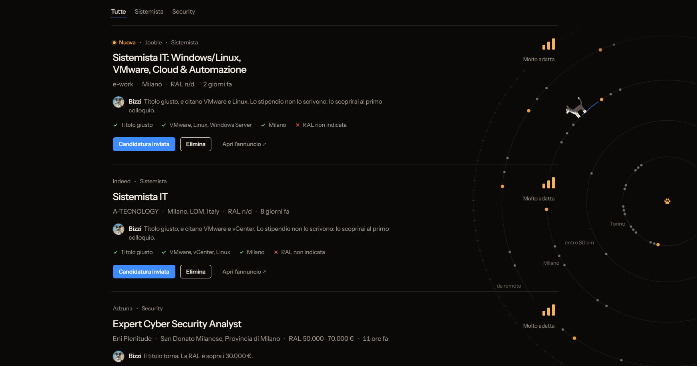
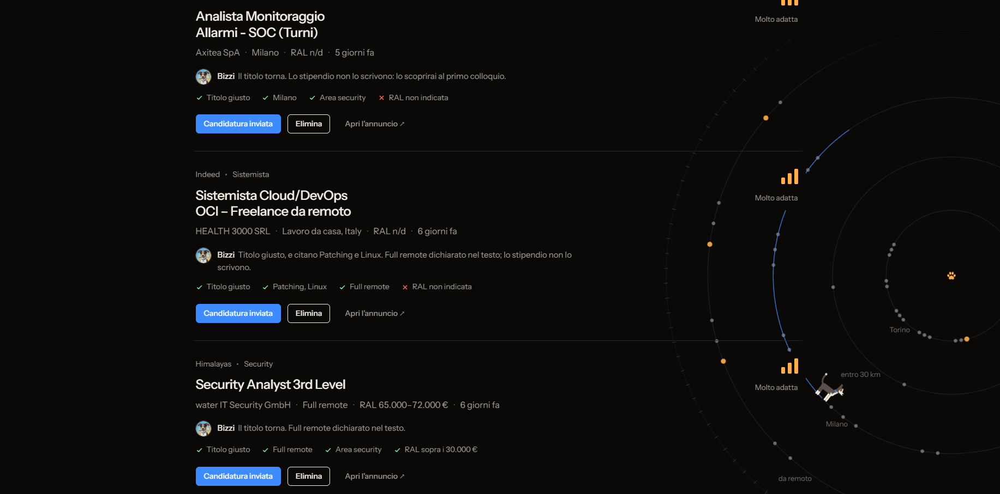

Scartare un'offerta richiede un clic e un motivo facoltativo, e per cinque secondi si può annullare:

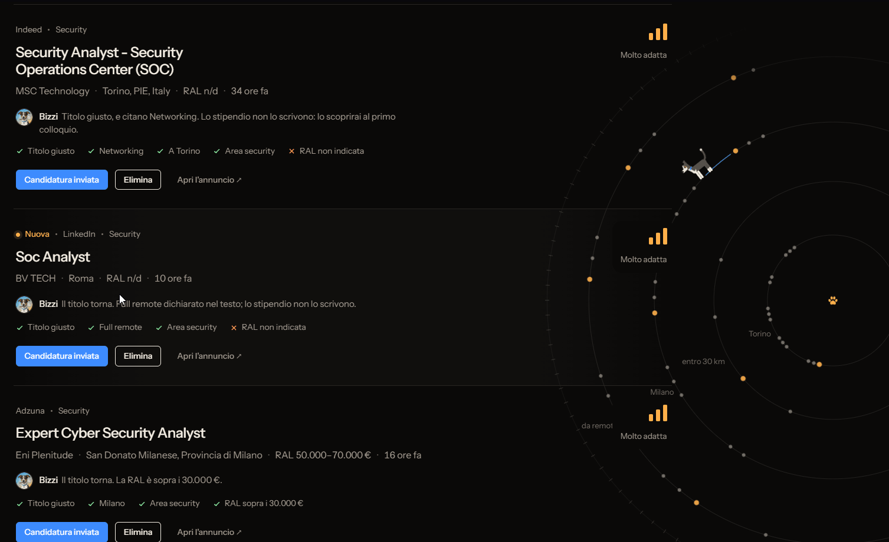

La vista per azienda mostra quante posizioni ha aperte ciascuna e quali sono nuove oggi:

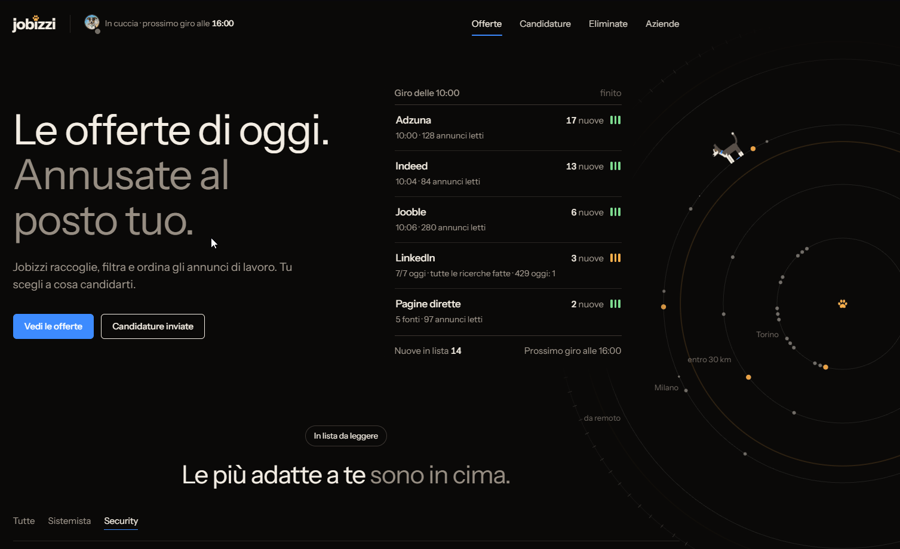

Lo stesso su Telegram, con le azioni ✓ / ✗ e il motivo dello scarto:

  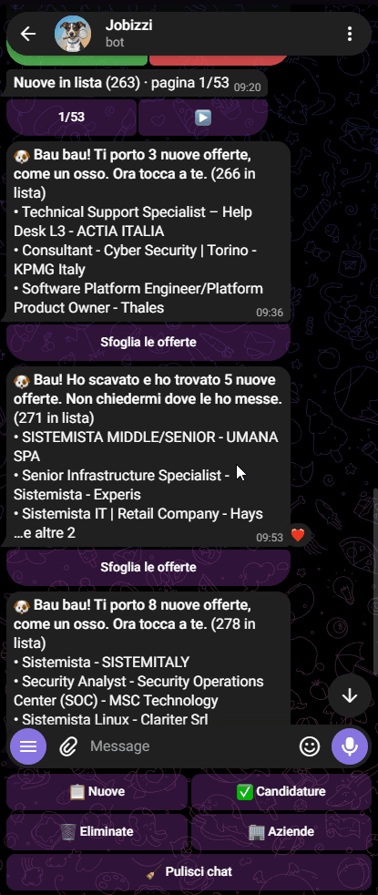

  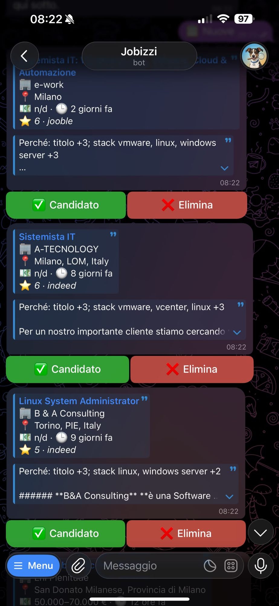
  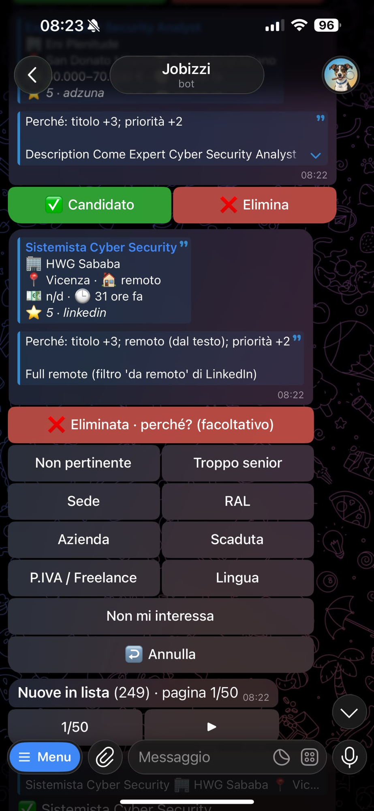

## Il flusso

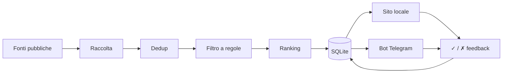

1. **Raccolta.** Aggregatori (Adzuna, Jooble), portali pubblici, feed RSS e pagine carriere di singole aziende. Le fonti più delicate stanno dietro un interruttore e un *circuit breaker*: si fermano se il blocco persiste. Le richieste sono sequenziali, con pause casuali.
2. **Dedup.** Una stessa offerta presente su più portali diventa una riga sola (finestra di 30 giorni, azienda obbligatoria, confronto fuzzy). Meglio un doppione che perdere un'offerta.
3. **Filtro a regole.** Zona (sede entro ~30 km oppure full remote), età massima dell'annuncio, RAL minima, punteggio per area di interesse. Le regole sono leggibili in un file YAML, non in un modello opaco.
4. **Ranking.** Un punteggio spiegabile: ogni offerta mostra perché è in alto (titolo, stack, sede, RAL) e quali sono i pro e i contro.
5. **Interfaccia.** Lista offerte, candidature inviate, scartate (con motivo e "rimetti in lista"), vista per azienda con il conteggio delle posizioni aperte.
6. **Pianificazione.** Un task pianificato lancia la raccolta tre volte al giorno. Un lock impedisce due raccolte insieme; il database ha un backup automatico giornaliero.

## Scelte di progetto

- **Locale e per un solo utente.** Nessun account, nessun server esterno, nessun accesso da internet.
- **Regole prima, modelli dopo.** Ho implementato anche uno stadio con un LLM locale (Ollama) e l'ho misurato su un campione di miei giudizi: non migliorava abbastanza, quindi è **spento**. Il verdetto che vedo nel sito si basa solo su ciò che le regole già calcolano.
- **Privacy per costruzione.** Non salvo email né nomi di recruiter: un filtro apposito li toglie prima della scrittura nel database.
- **Gentile con le fonti.** Pause casuali, nessuna richiesta in parallelo, backoff sugli errori 429, tetto giornaliero di richieste, interruzione se il blocco persiste. Niente login, cookie di sessione o captcha solving.
- **Parser scritti su dati reali.** Ogni collector è sviluppato su pagine reali salvate come fixture di test, mai su campi indovinati.
- **Esecuzioni idempotenti.** Rilanciare una raccolta non crea doppioni né rompe lo stato.

<strong>Dettagli tecnici</strong> (per chi vuole entrare nel merito)

### Schema dei dati (SQLite)

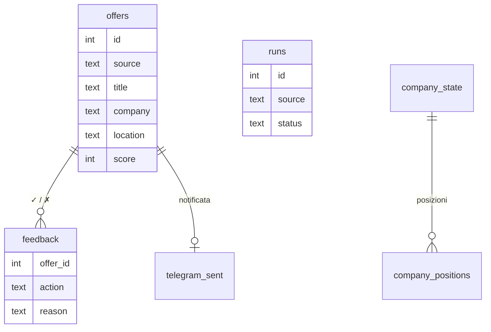

Altre tabelle: `linkedin_requests` e `linkedin_state` (pianificazione delle richieste), `telegram_state`.

### Architettura
Un orchestratore (`collect`) lancia un collector per fonte, tutti con la stessa interfaccia: restituiscono offerte normalizzate, poi dedup, regole e scrittura nel database. Moduli separati per regole, database, sito, bot Telegram, lock, backup e privacy. Il sito e il bot leggono e scrivono sullo stesso SQLite.

### Dedup
Tre livelli, dal più economico al più costoso: ID della fonte, URL canonico e hash del contenuto (con indici dedicati), poi confronto fuzzy su titolo e azienda con rapidfuzz. Vale solo dentro una finestra di 30 giorni e solo se l'azienda coincide. Ho scelto di tollerare i falsi negativi: un doppione costa un secondo, un'offerta persa costa di più.

### Ranking spiegabile
Il punteggio è la somma di contributi nominati (`titolo +3; stack vmware, linux +3; priorità +2`) salvati nel database con l'offerta. Il verdetto in linguaggio naturale e le tre barrette dell'interfaccia sono derivati da quegli stessi contributi, quindi sono sempre coerenti con il punteggio e verificabili.

### Affidabilità
- **Errori di rete:** su 5xx e timeout riprova con attese crescenti; le query che falliscono vengono recuperate in giri successivi dopo la notifica, e la riga del run passa da `error` a `ok` se rientra tutto. Verificato dal vivo su un'interruzione reale di una fonte.
- **Fonti delicate:** budget giornaliero di richieste, backoff esponenziale, stop del giorno se il blocco persiste.
- **Idempotenza:** rilanciare una raccolta non crea doppioni. Un lock su file impedisce due run contemporanei. Lo schema del database è versionato, con migrazioni.
- **Dati:** il database non si cancella mai; backup automatico giornaliero con rotazione.

### Test
349 test con pytest. I parser delle fonti sono scritti e verificati su pagine reali salvate (fixture), non su campi ipotizzati. Il lavoro non si considera finito se la suite non è verde.

### Una decisione misurata
Ho implementato uno stadio con un LLM locale per rivalutare le offerte, poi l'ho confrontato con i miei giudizi su 23 offerte, contando quante delle prime 10 in classifica finivano scartate da me (meno è meglio): 4 su 10 con le sole regole, 5 su 10 con il modello. Nessun miglioramento a fronte di costo e complessità, quindi l'ho spento. Il codice resta, disattivato da un flag.

### Sicurezza e privacy
Il sito non è esposto su internet e usa token CSRF. Il bot risponde solo a `chat_id` autorizzati (il mio; un secondo, in sola lettura). Le chiavi sono in un file `.env` fuori dal controllo versione. Email e nomi di recruiter vengono rimossi prima di salvare i dati.

### Come lavoro
Il progetto ha un file di stato con le decisioni già prese, il perimetro dichiarato (cosa il tool non farà mai) e un criterio di verifica: prima di aggiungere funzioni controllo che quelle esistenti diano risultati concreti, cioè offerte davvero rilevanti trovate, tempo risparmiato e candidature inviate.

## Come è stato sviluppato

Il codice è stato scritto in coppia con Claude Code, l'assistente di programmazione di Anthropic, usando modelli diversi a seconda del compito: i più potenti per le decisioni di progetto e i casi difficili, quelli più leggeri per le modifiche semplici. Non ho dato richieste sparse: il lavoro è guidato da istruzioni di progetto scritte da me (regole di qualità, perimetro, flusso di lavoro) e da un file di stato che tiene traccia delle decisioni. Le scelte di prodotto, le regole di filtro e ranking, e la verifica dei risultati restano mie. È anche una prova di come si lavora bene con questi strumenti: obiettivi chiari, test che devono passare e un revisore umano.

## Stack

Python 3.11+, SQLite, YAML, FastAPI + Jinja + HTMX, rapidfuzz per il dedup, pytest (349 test). Nessuna dipendenza pesante; nessun servizio a pagamento.

## Stato

Uso quotidiano da novembre 2026. Il progetto è in fase di osservazione: sto verificando che dia risultati concreti (offerte rilevanti, candidature inviate) prima di aggiungere altre funzioni.

**Prossimo passo:** spostarlo su un mini server Linux dedicato, così gira sempre acceso e separato da Windows, che ho usato come ambiente di sviluppo. Il codice Python è già portabile (l'unica parte specifica di Windows ha un ramo per gli altri sistemi); manca da scrivere l'avvio automatico con systemd al posto del task di Windows, e da provare tutto su Linux.

## Contatti

**Emanuele Famà**

- LinkedIn: [linkedin.com/in/emanuele-famà-58b9a02b5](https://www.linkedin.com/in/emanuele-fam%C3%A0-58b9a02b5)